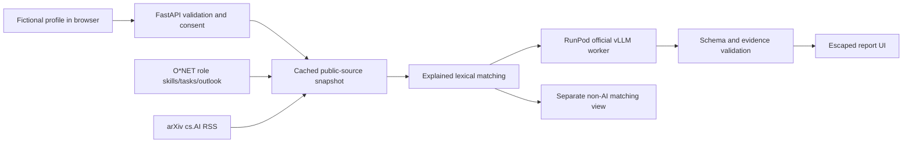

# Architecture and trust boundaries

The paid inference path is implemented but not live-verified. O*NET and arXiv
retrieval are live-tested. No database, account, CV upload, or profile persistence.

## Source decision

ESCO's official search API was reachable. It provides occupational/skill taxonomy,
not a time series of AI displacement or labour demand. O*NET was chosen for the
small initial cohort because its public pages expose tasks, skills and employment
outlook together. Direct BLS page retrieval returned HTTP 403 in our environment;
we do not bypass it. O*NET presents US BLS projection categories with their periods.
O*NET pages are parsed defensively; incomplete data is omitted, fewer than two roles
causes a visible error. A future production system should use a versioned O*NET
bulk release/API contract instead of depending on HTML selectors.

Five source IDs cover market research, project management, management analysis,
administration and data science. This is deliberate coverage, not an exhaustive
labour market. Source dates and retrieval time differ. Each snapshot receives a
content hash. Cached snapshots expire after an hour; explicit refresh is throttled
to one minute. No stale snapshot is silently substituted when a refresh fails.

arXiv provides four recent cs.AI entries, not validated employment evidence. Entries
may be unrelated to an occupation; the model must label weak relevance uncertain,
and reviewers must check interpretation. Titles/abstracts are context only; no
paper claims are treated as proof that jobs will disappear. Changing source content
changes the snapshot and model prompt. Changing a published growth category changes
its score component (covered by tests); this is not a causal model of AI disruption.

## Matching and inference

`matching.py` exposes a simple score: skill phrase/alias overlap (70), task/context
word overlap (20), published outlook category (10). Alias mappings and weights are
editorial. Missing mentions are unknown skills, not demonstrated deficiencies.
English lexical matching misses paraphrases and non-English text. It is not
calibrated for hiring, aptitude, qualification, or replacement probability.

`inference.py` submits actual input, current evidence and the report JSON schema to
RunPod's OpenAI-compatible vLLM endpoint. Proposed pretrained model:
`Qwen/Qwen3-4B-Instruct-2507`. Actual worker digest and model revision must be recorded
at deployment. No automatic retries that could create unexpected duplicate spend.
A user can retry after an error. Maximum output 6,500 tokens, upstream timeout 360s,
whole analysis deadline 420s. Cold starts/long outputs may fail and require tuning.

Server validation requires all capability lenses, literal input task/evidence
quotes, known citations, real retrieved role/skill IDs, two distinct role paths,
moderate/fast scenarios, four ordered weeks and weekly hour limits. Learning
resources are curated real documentation hubs; the model cannot create resource
links. No precise percentage or external URL is accepted in generated prose.
This reduces fabrication but cannot establish semantic entailment or prevent every
hallucinated course name in free text. Human evaluation is a release gate.

## Privacy and controls

The browser keeps profiles in memory only. API keys are backend-only. Profile fields
are bounded and contact patterns rejected; synthetic confirmation is mandatory.
The app does not log request bodies or store profiles. Source requests contain
fixed public role IDs/topics, not user text. RunPod receives the fictional profile;
provider/hosting logging policies remain applicable.

A shared demo code gates paid analysis. One in-flight analysis and 20 attempts/day
per process are defaults. These reset on process restart, so they are **not billing
caps**; deploy one instance and enforce provider budget controls. The backend serves
only explicit frontend filenames, disables API docs, adds CSP/no-store headers and
escapes model content. No tool execution, database access or user-provided URL fetch
is offered to the model. Prompt injection is still possible as text manipulation;
source/identity/time validation and human review bound the resulting risk.

## Interfaces for the team

- `GET /api/health`: configuration state, not an assertion of successful inference.
- `GET /api/radar?refresh=true`: public source snapshot with warnings and dates.
- `POST /api/match`: validated fictional profile → `source-matching` result; no model.
- `POST /api/analyze`: same profile + anonymous cookie / CSRF token → `real-ai` result only on success.
- `src/career/models.py`: shared request and output contract.
- `prototype/live.js`: API boundary and escaped rendering; no provider secret.

Coordinate contract changes with Y, C, L and Z before merging. The current upgrade
is a reviewable feature branch; no integration coordination has been claimed on
behalf of team members.

## Released cold-start transport

The browser submits to POST `/api/analyses` and polls GET `/api/analyses/{job_id}`
every three seconds with the same anonymous session cookie. The backend executes real
inference in a bounded background task and temporarily holds the result in memory.
The existing synchronous route remains available. No database was introduced.
